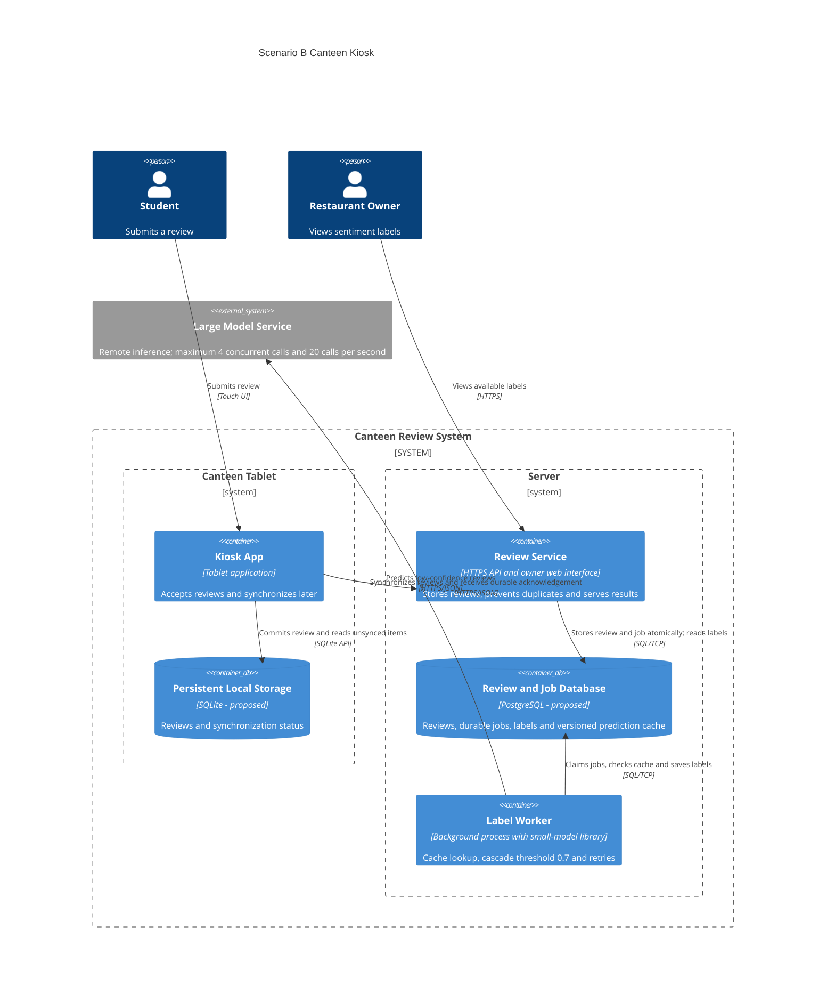

# Task 4: Deployment topologies and trade-offs

**Name / ชื่อ: Woraphan Supabphol**

**Student ID / รหัสนิสิต:6870243621**

This is **individual work**: each student completes and submits their own copy, in their own fork.

*งานนี้เป็น**งานเดี่ยว** นิสิตแต่ละคนทำและส่งงานของตัวเอง ใน fork ของตัวเอง*

**Scenario (A, B or C) / Scenario ที่เลือก: B**

Choose **one** scenario below. If the last digit of your student ID is odd, take A or B; if it is even, take B or C. Use your measurements from Tutorial 6 as evidence: cite run names from `results/runs.csv`. Answer in Thai or English.

เลือก scenario **หนึ่ง** ข้อด้านล่าง ถ้าเลขตัวสุดท้ายของรหัสนิสิตเป็นเลขคี่ ให้เลือก A หรือ B ถ้าเป็นเลขคู่ ให้เลือก B หรือ C ใช้ผลการวัดจาก tutorial ที่ทำไปเป็นข้อมูลอ้างอิง โดยอ้างชื่อ run จาก `results/runs.csv` จะตอบเป็นภาษาไทยหรือภาษาอังกฤษก็ได้

Facts that hold in every scenario / ข้อเท็จจริงที่ใช้กับทุก scenario:

- The large model serves at most **20 calls per second** (4 calls at once × about 200 ms each), and every call costs money.

  *large model รับได้สูงสุด **20 calls ต่อวินาที** (พร้อมกัน 4 calls × ประมาณ 200 ms ต่อ call) และทุก call มีค่าใช้จ่าย*
- The small model is fast and cheap enough to run anywhere, including inside the review service or on a kiosk, but it is much less accurate on its own.

  *small model เร็วและถูกพอที่จะรันที่ไหนก็ได้ รวมถึงภายใน review service หรือบน kiosk แต่ถ้าใช้ตัวเดียวจะแม่นน้อยกว่ามาก*

## Scenarios

**A. Owner alerts.** When a customer posts a negative review, the restaurant owner gets a push notification within **2 seconds**. At the lunch peak, CampusEats receives **40 reviews per second**. A missed alert is acceptable, but a wrong alert (for example, "your customer is unhappy" when they are happy) makes owners stop trusting alerts and, in the end, ignore them.

*เมื่อลูกค้าโพสต์รีวิวเชิงลบ เจ้าของร้านจะต้องได้รับ push notification ภายใน **2 วินาที** เวลาช่วงพีคตอนเที่ยง CampusEats ได้รับรีวิวจำนวน **40 รายการต่อวินาที** การพลาด alert ไปบ้างนั้นยอมรับได้ แต่ alert ที่ผิด (เช่น "ลูกค้าไม่พอใจ" ทั้งที่จริงๆ แล้วพอใจ) จะทำให้เจ้าของร้านไม่เชื่อถือและเลิกสนใจ alert ในที่สุด*

**B. Canteen kiosk.** A tablet in each canteen lets students leave a review on the spot. However, the canteen Wi-Fi is poor: the tablets lose their connection several times a day, for minutes at a time. The system must accept every review, even while a tablet is offline. Restaurant owners need the labels **by the end of the day**.

*มี tablet ในแต่ละโรงอาหารให้นิสิตรีวิวได้ทันที อย่างไรก็ดี การเชื่อมต่อ Wi-Fi ในโรงอาหารไม่ดี ทำให้ tablet หลุดการเชื่อมต่อวันละหลายครั้ง ครั้งละหลายนาที ระบบจะต้องรับรีวิวได้ทุกรายการแม้ขณะที่กำลัง offline อยู่ และเจ้าของร้านต้องการ label **ภายในสิ้นวัน***

**C. Weekly report.** Restaurant owners want a weekly sentiment report. Nothing in producing this report has to be real-time. **Accuracy matters most** and **cost must be minimal**.

*เจ้าของร้านต้องการรายงาน sentiment รายสัปดาห์ ไม่มีอะไรที่จะต้องทำแบบ real-time ในการออกรายงานนี้ ความแม่นยำ **(accuracy) สำคัญที่สุด** และ **ค่าใช้จ่ายต้องน้อยที่สุด***

## Topologies and patterns to choose from / Topology และ pattern ที่เลือกใช้ได้

| | Topology | Where the model runs / โมเดลรันที่ไหน |
|---|---|---|
| T1 | Model as a service, synchronous | Inference service, called for each review (today's baseline) *inference service ถูกเรียกทุกรีวิว (baseline ของวันนี้)* |
| T2 | Model as a library | Inside the review service, or on the device *ภายใน review service หรือบนอุปกรณ์* |
| T3 | Hybrid | Small model locally, large model as a remote service *small model รันในเครื่อง large model เป็น remote service* |
| T4 | Asynchronous / batch | Reviews are queued (broker, W10) or stored, and scored later in bulk *รีวิวถูกเข้าคิว (broker, W10) หรือเก็บไว้ แล้วติด label ทีหลังเป็นชุด* |

Combine one topology with any of the patterns from Tutorial 6: **fallback**, **cascade** and **cache**.

*เลือก topology หนึ่งแบบ แล้วผสมกับ pattern จาก Tutorial 6 ได้ตามต้องการ: **fallback**, **cascade** และ **cache***

## 1. Quality requirements

The three most important quality requirements for your scenario, each with a number where possible.

*quality requirements ที่สำคัญที่สุด 3 ข้อของ scenario ที่เลือก ระบุตัวเลขเมื่อทำได้*

| # | Quality | Requirement |
|---|---|---|
| 1 | Availability | ระบบต้องรับรีวิวทุกรายการที่นิสิตส่งผ่าน tablet ได้ทั้งขณะออนไลน์และ offline |
| 2 | Data integrity | ระบบต้องรักษารีวิวที่ยืนยันว่ารับสำเร็จให้ครบถ้วนตรงกับต้นฉบับตลอดการจัดเก็บและ sync โดยไม่มีข้อมูลสูญหายหรือรายการซ้ำ |
| 3 | Timeliness | ระบบต้องทำให้เจ้าของร้านเข้าถึง sentiment label ของรีวิวทุกรายการที่รับในวันนั้นได้ภายในสิ้นวันเดียวกัน |

## 2. Design / การออกแบบ

Your topology, the patterns you add, and a container-level diagram (C4 level 2). The C4 diagram must be written in Mermaid.

*topology ที่เลือก pattern ที่เพิ่ม และ diagram ระดับ container (C4 level 2) เขียนด้วย Mermaid*

> เลือก topology T4: Asynchronous / batch โดยประมวลผลเบื้องหลังอย่างต่อเนื่องหลังรีวิว sync ถึง server เพื่อกระจายงานและเหลือเวลารองรับปัญหาก่อนสิ้นวัน ร่วมกับใช้ Cache และ Cascade โดยตรวจสอบ Cache ก่อน หากมีผลทำนายของข้อมูลเข้าเดิมที่ใช้ pipeline เวอร์ชันเดียวกัน ให้นำผลนั้นมาใช้ทันที หากไม่พบจึงใช้ Cascade ให้ small model ทำนายก่อน เมื่อ confidence ผ่าน threshold ที่ 0.7 ให้ใช้ผลนั้น หากไม่ผ่านจึงเรียก large model วิธีนี้ช่วยลดจำนวน calls ที่มีค่าใช้จ่ายและลดภาระของ large model

## 3. Evidence / หลักฐาน

Which runs support your choice? Show the numbers and, for scenario A, the capacity arithmetic: how many large-model calls per second does your design need at the peak?

*run ไหนที่สนับสนุนการตัดสินใจของนิสิต ให้นิสิตแสดงตัวเลขประกอบ และสำหรับ scenario A ให้นิสิตแสดงการคำนวณ capacity ด้วย เพื่อแสดงว่าในช่วงพีคนั้น design ของนิสิตต้องใช้ large model กี่ calls ต่อวินาที*

| Run | What it shows / แสดงอะไร |
|---|---|
| t0-large | Baseline ใช้ large model ทุกรีวิว ได้ accuracy 93.5% และ large calls 100% |
| t1-after | แม้ errors เป็น 0 แต่ยังมี pending 26 รายการ จึงต้องประมวลผลรายการค้างต่อภายหลัง |
| t2-0.7 | Cascade ที่ threshold 0.7 ลด large calls เหลือ 53% โดยได้ accuracy 93.0% |
| t3-cache | Cascade ร่วมกับ Cache ลด large calls เหลือ 38% โดย accuracy ยังเป็น 93.0% และมี cache hits 35% |

> ผล t2-0.7 และ t3-cache สนับสนุนการใช้ Cascade ร่วมกับ Cache โดยลดการเรียก large model จาก baseline 100% เหลือ 38% ขณะที่ accuracy ลดจาก 93.5% เป็น 93.0% ส่วน t1-after แม้ errors เป็น 0 แต่ยังมี pending 26 รายการ จึงสนับสนุนการมีงานเบื้องหลังเพื่อสร้าง label ให้รายการที่ยังค้าง ทั้งนี้ ผลทดลองยังไม่ยืนยันการรับรีวิว offline การ sync โดยไม่สูญหาย หรือการสร้าง label ครบภายในสิ้นวัน ซึ่งต้องทดสอบเพิ่มเติม

## 4. ADR

Use the ADR format from W5.

*ใช้รูปแบบ ADR จาก W5*

**Title:เลือก T4: Asynchronous / batch พร้อมรองรับการรับรีวิว offline และใช้ Cache ร่วมกับ Cascade**

**Status:Proposed**

**Context:**
> Wi-Fi ในโรงอาหารไม่เสถียร แต่ระบบต้องรับรีวิวได้แม้ tablet อยู่ในสถานะ offline และเจ้าของร้านต้องเข้าถึง label ภายในสิ้นวัน จึงต้องแยกการรับรีวิวออกจากการสร้าง label โดยคำนึงถึง Availability, Data integrity และ Timeliness อีกทั้ง large model มีค่าใช้จ่ายทุก call และรองรับสูงสุด 20 calls/second

**Decision:**
> เลือก T4 โดยบันทึกรีวิวลงพื้นที่เก็บถาวรบน tablet ก่อนยืนยันว่ารับสำเร็จ แล้ว sync เมื่อออนไลน์ โดยใช้ review ID ป้องกันรายการซ้ำและให้ server ตอบรับหลังบันทึกถาวร จากนั้น worker ประมวลผลงานเบื้องหลัง โดยตรวจ Cache ก่อน หากไม่พบผลที่ตรงกับข้อมูลเข้าและเวอร์ชัน pipeline จึงใช้ Cascade ให้ small model ทำนาย และเรียก large model เมื่อ confidence ไม่ผ่าน threshold ที่ 0.7 พร้อมควบคุมไม่เกิน 4 calls พร้อมกันและ 20 calls/second หากประมวลผลไม่สำเร็จให้เก็บงานไว้ retry

**Consequences:**
- Positive:รับรีวิวขณะ offline ได้ และรองรับการ sync ซ้ำโดยไม่สร้างรีวิวซ้ำ ส่วน Cache ร่วมกับ Cascade ช่วยลดภาระและค่าใช้จ่ายของ large model โดย t3-cache ใช้ large calls 38% เทียบกับ t0-large ที่ 100%
- Negative:เพิ่มความซับซ้อนในการจัดเก็บบน tablet การ sync การ retry และการจัดการเวอร์ชัน Cache โดย accuracy ในผลทดลองลดจาก 93.5% เป็น 93.0% และยังเสี่ยงไม่ทันสิ้นวันหาก tablet กลับมาออนไลน์ช้าหรือมีงานค้างมาก

**Alternatives considered:** at least one topology you rejected, and why.
*อย่างน้อยหนึ่ง topology ที่ไม่เลือก และเหตุผล*
>
- T1: Synchronous: หากต้องรอ remote model ก่อนรับรีวิว จะรับรีวิวขณะ offline ไม่ได้ จึงไม่เลือกเป็นแนวทางหลัก
- T2: Small model บน tablet อย่างเดียว: สร้าง label ขณะ offline ได้ แต่ t0-small มี accuracy 72.5% และยังต้อง sync ผลให้เจ้าของร้าน

